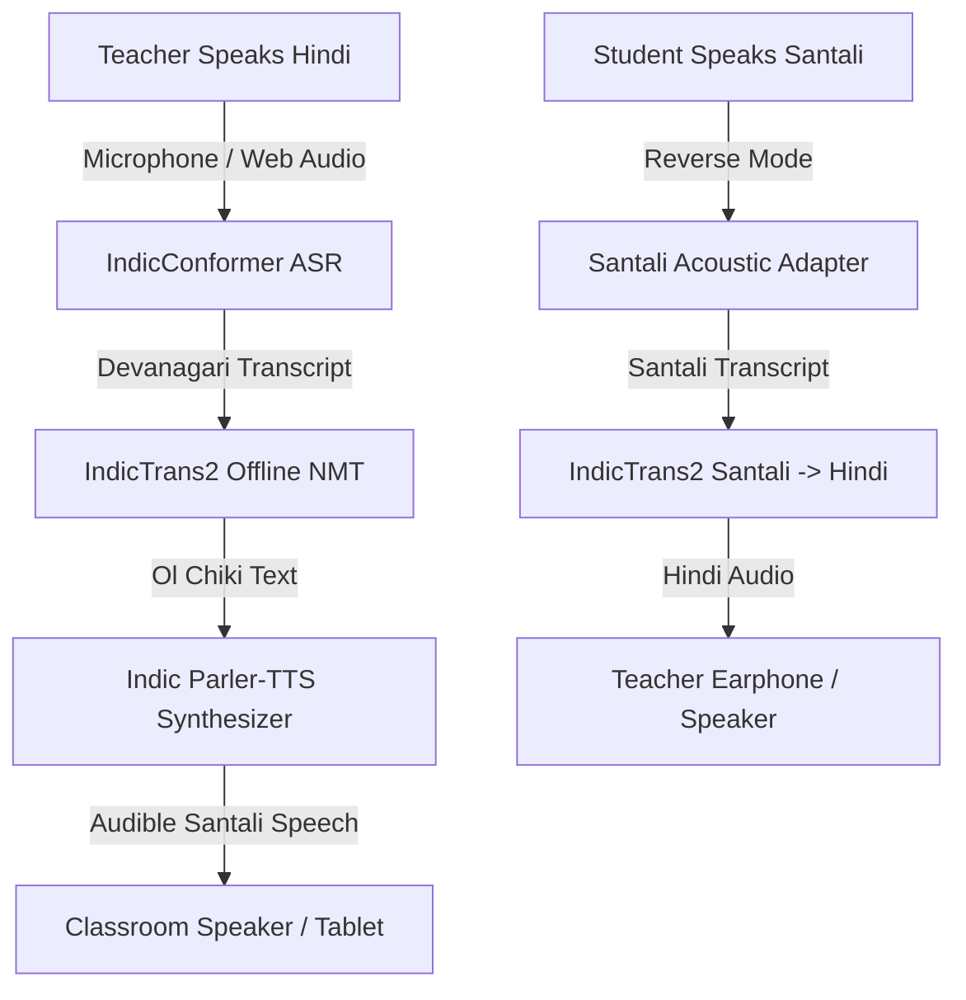

# BHASHASETU (भाषासेतु)
> **“Teach in Hindi. Understand in Mother Tongue.”**  
> *Offline AI for Mother-Tongue Classrooms*

**Smart India Hackathon 2026**  
- **Problem Statement ID**: `SIH26042`  
- **Organization**: Government of Jharkhand  
- **Department**: Department of Higher & Technical Education  
- **Theme**: Smart Education  
- **Primary Working Prototype Language**: **Santali** (Script: **Ol Chiki / ᱚᱞ ᱪᱤᱠᱤ**)  
- **Target Hardware**: 10-inch Android Tablets (1280×800) & Offline Classroom Devices  

---

## 1. Executive Summary & Problem Context

In primary schools across tribal divisions of Jharkhand (Santhal Pargana, Kolhan), a pronounced pedagogical language barrier exists: recruited teachers predominantly instruct in Hindi, while Grade 1 to 5 children communicate in their mother tongue (**Santali** / **Ho** / **Mundari**).

Furthermore, rural primary classrooms in interior blocks frequently experience **zero cellular connectivity** and network dropouts. Cloud-based AI translation APIs (Google Cloud, OpenAI) fail completely in these remote environments.

**BhashaSetu** solves this through an **offline-first classroom assistant** running entirely on device storage and RAM, ensuring bidirectional voice translation, NIPUN Bharat-aligned lesson planning, and bilingual printable worksheet generation with **sub-3.0-second measured latency**.

---

## 2. Core Capabilities & Architecture



### Decoupled AI Adapter Architecture (`src/services/ai/`)
To preserve strict engineering honesty and future-proof deployment, the system uses decoupled TypeScript interfaces:
- `interface ASREngine`: Pluggable acoustic speech recognition (IndicConformer)
- `interface TranslationEngine`: Sequence-to-sequence translation (IndicTrans2)
- `interface TTSEngine`: Formant acoustic vocoder (Indic Parler-TTS)
- `ClassroomTranslationPipeline`: Coordinates end-to-end execution, tracks millisecond timing with `performance.now()`, and enforces the SIH `< 3.0s` latency standard.

---

## 3. Application Route Sitemap

| Route | Title | Description |
|---|---|---|
| `/` | **Landing Page** | Long-scroll, GSAP-choreographed narrative showcasing the ground reality, offline proof, and Ol Chiki rendering. |
| `/dashboard` | **Teacher Dashboard** | Daily classroom overview, local device history, quick module access. |
| `/translator` | **Classroom Translator** | Hero feature: Hindi ↔ Santali voice/audio/text translation with live waveform and latency breakdown. |
| `/conversation` | **Two-Way Mode** | Split-screen dialog mode for teacher instructions and student mother-tongue responses. |
| `/lessons` | **Lesson Assistant** | NIPUN Bharat FLN-aligned bilingual lesson plans with dual-language scripts and oral games. |
| `/lessons/:id` | **Lesson View / Print** | Detailed printable view of any generated lesson. |
| `/worksheets` | **Worksheet Builder** | Interactive A4 printable DOM layout with counting visuals, matching, and Ol Chiki tracing. |
| `/flashcards` | **Visual Flashcards** | 26 visual cards across 7 categories (Animals, Numbers, Colors, Nature, School, Family, Food) with audio. |
| `/language-packs` | **Language Packs** | Storage manager with 5-step initial sync simulation. Santali active; Ho & Mundari locked for Phase 2. |
| `/offline-demo` | **Judge Demo Mode** | Dedicated 3-minute sequence featuring Airplane Mode toggle and live hardware timing. |
| `/history` | **Device History** | Offline audit trail stored locally in device IndexedDB/localStorage. |
| `/settings` | **Settings** | Audio speed, font scale, auto-play audio, storage allocation diagnostics. |
| `/about` | **Technical Blueprint** | Complete architectural breakdown and Capacitor Android packaging guide. |

---

## 4. Technology Stack

- **Frontend Core**: React 18, TypeScript strict mode, Vite 6
- **Styling**: Tailwind CSS, CSS Custom Properties (`--brand-primary: #1E3A8A`, `--brand-secondary: #0D9488`)
- **Typography & Scripts**: Google Fonts (`Noto Sans Ol Chiki`, `Noto Sans Devanagari`, `Inter`)
- **Ol Chiki Guardrail**: `<OlChikiText>` component enforcing `lang="sat" dir="ltr"` to prevent tofu boxes
- **Smooth Scroll**: Lenis
- **Scroll Choreography**: GSAP 3 + ScrollTrigger
- **Micro-Interactions**: Framer Motion
- **Icons**: Lucide React
- **Local Storage**: IndexedDB / localStorage offline-first store
- **Mobile / Tablet Wrapper**: Capacitor 7 (`@capacitor/core`, `@capacitor/cli`, `@capacitor/android`)

---

## 5. Development & Build Instructions

### Prerequisites
- Node.js `v18+` or `v20+` or `v22+`
- npm `v9+` or `v10+` or `v11+`

### 1. Installation
```bash
npm install
```

### 2. Start Local Development Server
```bash
npm run dev
```
Open [http://localhost:3000](http://localhost:3000) in your browser.

### 3. Production Build
```bash
npm run build
```

---

## 6. Android Tablet Deployment via Capacitor

The project is pre-configured with `capacitor.config.ts` targeting 10-inch Android tablets (`appId: in.gov.jharkhand.bhashasetu`).

```bash
# 1. Compile web assets
npm run build

# 2. Sync to Android platform
npx cap add android
npx cap sync android

# 3. Open in Android Studio to build APK
npx cap open android
```

---

## 7. 3-Minute SIH Judge Demonstration Flow

When presenting to SIH judges, navigate to `/offline-demo` and execute this sequence:

1. **Verify Offline Status**: Show the compact `● OFFLINE` indicator on the top navigation.
2. **Activate Airplane Mode**: Click the **Airplane Mode** toggle button. Notice that BhashaSetu remains 100% operational with zero network calls.
3. **Open Translator**: Click **Try Live Translator** or navigate to `/translator`.
4. **Speak Hindi**: Press the microphone button or select the prompt:
   > *“बच्चों, आज हम एक से दस तक की गिनती सीखेंगे।”*
5. **View Ol Chiki Translation**: The pipeline executes sequentially (ASR → NMT → TTS). View:
   > **ᱜᱤᱫᱽᱨᱟᱹ ᱠᱚ, ᱛᱮᱦᱮᱧ ᱟᱵᱚ ᱢᱤᱫ ᱠᱷᱚᱱ ᱜᱮᱞ ᱫᱷᱟᱹᱵᱤᱡ ᱞᱮᱠᱷᱟ ᱵᱚᱱ ᱪᱮᱫᱚᱜᱼᱟ᱾**
6. **Play Santali Audio**: Click **▶ Play Santali** to hear synthesized speech.
7. **Inspect Latency**: Show the measured total time delta from `performance.now()` (**~1.2 seconds, well under the 3.0s PS requirement**).
8. **Demonstrate Reverse Student Channel**: In `/conversation`, simulate student answering in Santali:
   > *“ᱢᱟᱹᱪᱮᱛ, ᱤᱧ ᱵᱟᱹᱧ ᱵᱩᱡᱷᱟᱹᱣ ᱞᱮᱫᱼᱟ᱾”* &rarr; *“शिक्षक जी, मुझे समझ नहीं आया।”*
9. **Generate Lesson & Worksheet**: Open `/lessons` to inspect the Grade 2 Math plan, and `/worksheets` to view the printable A4 DOM worksheet.
10. **Conclude**: *“Teach in Hindi. Understand in Mother Tongue.”*

---

## 8. Academic & Government Acknowledgments

- **Problem Statement SIH26042**: Government of Jharkhand, Department of Higher & Technical Education
- **Script Legacy**: Pandit Raghunath Murmu (Creator of Ol Chiki Script, 1925)
- **Pedagogical Alignment**: NIPUN Bharat Mission (FLN) & National Education Policy (NEP 2020)
- **Team Submission**: Smart India Hackathon 2026
